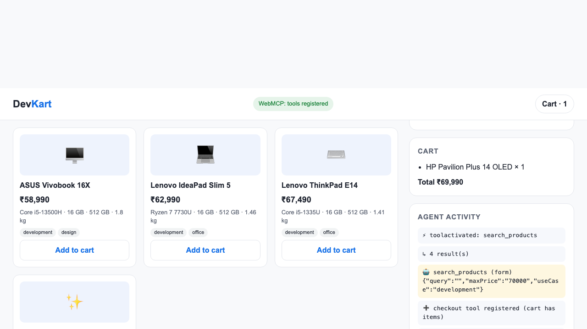

# DevKart: a WebMCP + Chrome Built-in AI demo

A small laptop store that AI agents can use through **WebMCP**, built for the talk
*From Clicks to Conversations* at GDG DevFest Rajkot 2026.

**Live demo:** https://dadiyanidhi.github.io/devkart-webmcp/



## What it shows

- **Declarative tool:** the search `<form>` becomes the `search_products` tool through the
  `toolname` and `tooldescription` attributes.
- **Imperative tools:** `get_product_details`, `compare_products`, `add_to_cart`, `view_cart`
  and `checkout`, registered with `document.modelContext.registerTool()`.
- **Dynamic tools:** `checkout` is registered only while the cart has items.
- **Human in the loop:** `checkout` uses `consequentialHint: true` and the page asks before placing the order.
- **Prompt API (Gemini Nano):** the "Understand" box turns a sentence into search criteria
  with a JSON `responseConstraint`, then validates the result. Without the model, a simple parser is used.

Each tool in the page is tagged **DECLARATIVE** or **IMPERATIVE**.

## Try it

1. Use Chrome 155 or newer.
2. Enable `chrome://flags/#enable-webmcp-testing` and `chrome://flags/#prompt-api-tool-use`, then relaunch Chrome.
3. Install an agent:
   - [WebMCP extension](https://github.com/GoogleChromeLabs/webmcp-extension) (recommended), or
   - [WebMCP – Model Context Tool Inspector](https://chromewebstore.google.com/detail/webmcp-model-context-tool/gbpdfapgefenggkahomfgkhfehlcenpd)
4. Open the [live demo](https://dadiyanidhi.github.io/devkart-webmcp/) and ask:
   > I need a laptop for React development under ₹70,000. Compare the two best options and add the lighter one to my cart.

## Run locally

```bash
python3 -m http.server 8765
```

Open http://localhost:8765. WebMCP needs a secure context, so use `localhost` or HTTPS.

See [DEMO-RUNBOOK.md](DEMO-RUNBOOK.md) for the full talk script.

## More demos

- [Scraping vs WebMCP explainer](https://googlechromelabs.github.io/webmcp-tools/demos/explainer/)
- [React flight search](https://googlechromelabs.github.io/webmcp-tools/demos/react-flightsearch/)
- [French bistro](https://googlechromelabs.github.io/webmcp-tools/demos/french-bistro/)
- [Rocket launcher](https://bandarra.me/apps/webmcp-rocketlauncher/?mode=static)
- [Analytics dashboard](https://googlechromelabs.github.io/webmcp-tools/demos/analytics-dashboard/)
- [Pixel art studio](https://googlechromelabs.github.io/webmcp-tools/demos/pixel-art-studio/)
